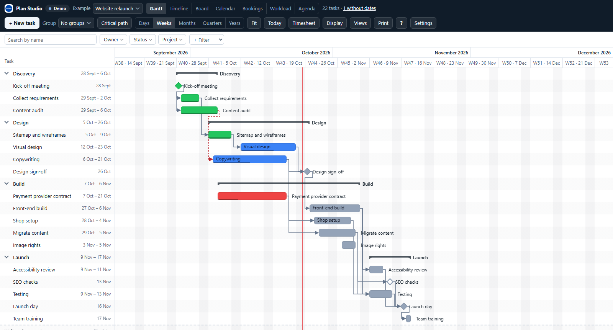
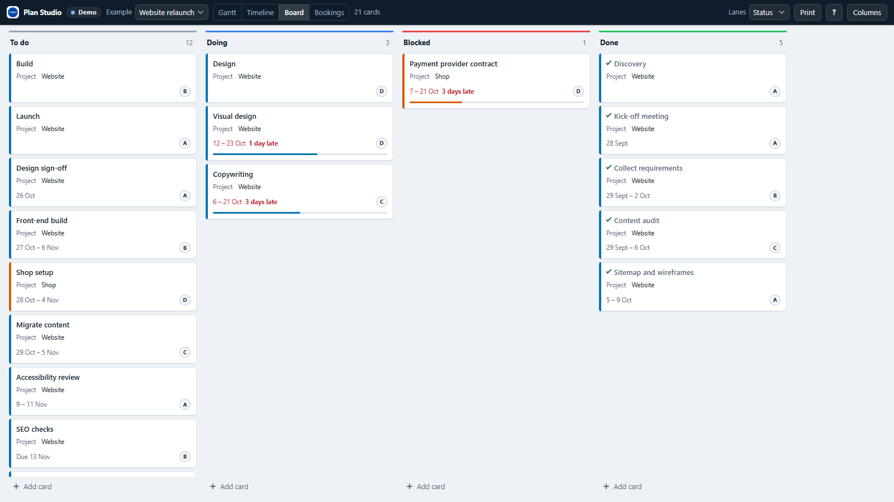
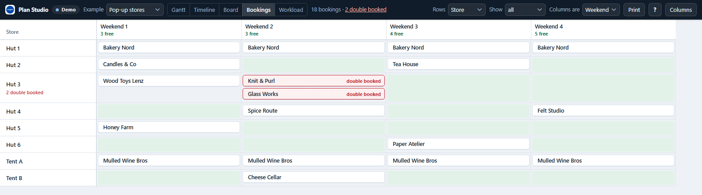
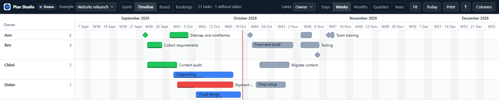
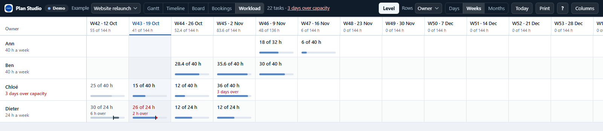
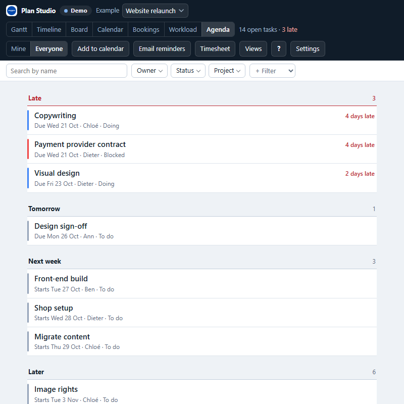
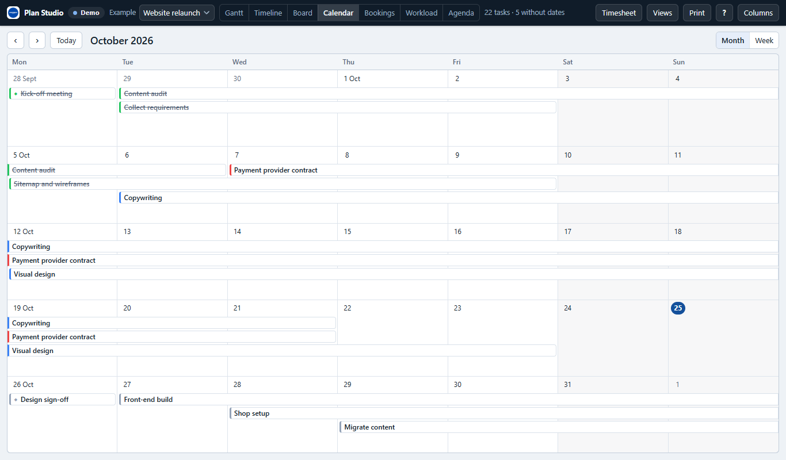
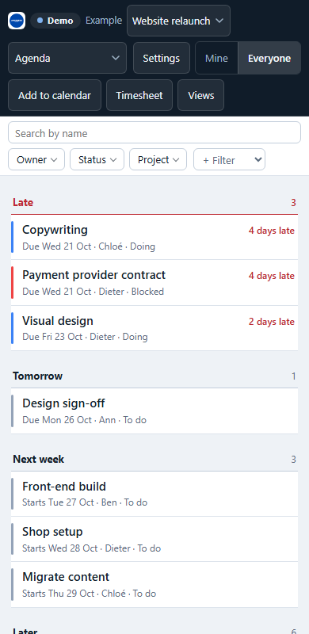

# Plan Studio — a custom widget for Grist (by ANUPRESS)

[](LICENSE)
[](CHANGELOG.md)
[](https://anupress.github.io/grist-plan-studio/)

Plan Studio shows a table you already keep in Grist as a **Gantt chart**, a **timeline**, a
**board**, a **calendar**, a **booking grid**, a **workload** or an **agenda** for your phone, and writes every change
straight back to that table. It maps onto your own columns, follows Grist's filters and linking, prints to PDF,
and runs entirely in the viewer's browser: there is no server, and nothing leaves your document.

Paste this into Grist (**Add widget → Custom → Enter Custom URL**):

```
https://anupress.github.io/grist-plan-studio/
```



## Try it without Grist

Opened in a plain browser tab, the widget runs on sample data and saves nothing:

- **[A website relaunch](https://anupress.github.io/grist-plan-studio/)**: every view, switched
  from the toolbar
- **[Pop-up stores over weekends](https://anupress.github.io/grist-plan-studio/?example=stores)**:
  the booking grid, with no dates at all

## The seven views

| View | Rows are | What you do in it |
|---|---|---|
| **Gantt chart** | tasks, with parents and dependencies | drag bars and their ends, link tasks, fold parents, show the critical path |
| **Timeline** | a band per person, room or project | drag a bar to another band to reassign it, or along it to move its dates |
| **Board** | cards in a lane per status, person or any other column | drag cards between and within lanes, add cards, set lane limits |
| **Calendar** | a month or a week, a bar for each task on its days | drag a bar to another day; the task keeps its length |
| **Booking grid** | resources × days, weeks, months or your own periods | see free cells counted per period, click one to book it, spot double bookings |
| **Workload** | people × days, weeks or months, hours against capacity | see who is over and when, list the tasks behind a cell, **Level** the plan |
| **Agenda** | open tasks under the day they need someone | late first, then today, tomorrow and the weeks ahead; **Mine** or **Everyone**; the first view on a phone |













## Workload and levelling

Each person gets a row, and each cell the hours asked of them against the hours they have. Hours come
from an **Hours of work** column (or person-days, when its name says days), spread over the task's
working days and split between its people; without one, each task takes a full working day of each of
its people, and the view says it assumes so. Capacity is 8 hours on every working day (set in
**Columns**), scaled by a column of the people table: hours a week (40, 24) or a share (0.5, 50 %).
Weekends, public holidays and a holidays table count as days off; a row of that table that names a
person is that person's day off.

With a time-entries table (see [Time tracking](#time-tracking)), the toolbar switches between
**Planned**, **Logged** and **Remaining** hours. Logged shows the time entries on their days, against
each person's capacity. Remaining takes the time logged on each task off its hours and spreads the rest
over its working days from today on; a task that should have ended puts what is left on the next
working day, and its cell says it is late.

**Level** moves tasks later until nobody is over capacity, in the plan or, in Remaining, in what is left of it. Only tasks that take part in an overload
move, each inside its slack: it still ends before anything that waits for it, before its due date and
by the end of the plan, so no other task has to move. Tasks that have started, are done, are milestones
or parents, or have dates from formulas stay where they are. You see the moves before anything is
written, and one Undo takes them all back.

## Use it in Grist

1. In your document, add a widget and choose **Custom**.
2. Paste the widget URL (above) into **Enter Custom URL**.
3. Accept **Full document access** when Grist asks.

Full access is needed because the widget reads more than its own table (the people a task is
assigned to, a holidays table, the periods of a booking grid), reads column types so it never writes
a formula, and writes your changes back. It shows the table you chose when adding the widget.

**Your columns, not ours.** Plan Studio never asks for a schema. It works out which column is the
start, the end, the due date, the assignee, the status and so on, and the **Columns** button shows
what it found and lets you change it:

- Grist's Project Management, Lab Project Management, Rental Management and Content Calendar
  templates are recognised whole and need no setup.
- Any other table is matched by column names in English, German and French. A role with no column
  offers **Add a column for it**.
- An empty table (Grist's new Table1) offers three starter templates: a project plan, an event
  booking plan and a room booking. Each asks first, and Grist's Undo takes it back.

**Every change is one Grist action.** A drag writes one row, or one bundle when dependants move
with it, so one Ctrl+Z, in Grist or in the widget, takes the whole change back. Formula columns are
never written. When access rules refuse a write, the widget puts the bar back and shows Grist's
reason.

**Linking works both ways.** Select by a People or Projects list and the widget narrows to it; new
tasks, cards and bookings get the selected value so they stay in view. Picking a task moves Grist's
cursor, so a linked card shows it.

Plan Studio works the same in **Grist Desktop** (tested in 0.3.16 on Windows).

**Self-hosted Grist** can offer Plan Studio, Advanced Charts and Invoice Studio in its Custom widget
picker, with nothing to paste: start Grist with `GRIST_WIDGET_LIST_URL` set to
`https://anupress.github.io/grist-plan-studio/manifest.json`.

## Printing

**Print** in the toolbar (or Ctrl+P in the widget) prints the view on show, A4 or A3 landscape. A
Gantt chart or timeline either fits the page width or keeps its zoom, split into page-wide slices.
Every page repeats the title and the header, and rows never split across a page edge. Choose "Save
as PDF" in the browser's print dialog for a PDF. **Save as PNG**, in the same panel, draws the same layout as
a picture for a slide or a message. It is drawn by the browser from the printout, so it is the layout of the
printout, in light colours whatever the theme; a plan too large for a picture says so and points to the PDF.
Tested in Chrome: a browser that will not draw it says so too. The agenda has no printout.

## Languages and keys

English, German and French, following Grist's language (or chosen in Columns). Dates, week
numbers and key names follow the language.

The main actions have keys: arrows select, Alt+arrows move, Enter opens quick edit, Ctrl+Z
undoes. **?** lists the keys of the view on show. Dialogs keep the focus and give it back, a
selection is announced to screen readers, and the booking grid has a cell cursor.

## Time tracking

Hours worked go in a table of their own, beside the tasks: a row per entry, with the task, the person,
the day, a start and an end (from a timer) or just hours (logged by hand), and a note. Plan Studio
finds such a table by its columns, or picks one in **Columns**; without one, **Columns → Time
tracking → Add a time-entries table** makes it after asking (Task, Person, Date, Started, Stopped,
Hours, Note, named in the interface language).

- **A timer** starts from a task's quick edit (Enter on a bar or a card). It is a row with a start and
  no end, so it lives in the document: it keeps running through a reload, a closed laptop or another
  browser. The toolbar shows it with its task and time, and Stop. Starting another stops the first in
  the same step; a timer stopped within a minute logs nothing. Each start and stop is one Undo.
- **Logged against planned**: a card says "36 of 60 h logged", or how many hours over; the quick edit
  and the Gantt bar's tooltip say how many are left.
- **The workload** shows the hours logged, or what remains of the plan once they are taken off.
- **The timesheet** shows one person's week, or everyone's: a row per task, the hours of each day and
  the totals, against the hours that person has that week. A click on a day logs time there, and
  **Download CSV** hands the week's entries to a spreadsheet (semicolons and decimal commas where the
  language writes them so).

Grist does not tell a widget who is signed in, so Plan Studio asks whose timer it is the first time
and remembers the answer in this browser.

## Agenda, calendar and reminders

The **Agenda** lists the tasks that are not finished (Done ticked, progress full, or a status such as
Done, Erledigt or Terminé) under the day they next need someone: **Late**, with how many days, then
**Today**, **Tomorrow**, **Under way**, this week, next week, later, and the tasks with no date. A table
that cannot say a row is finished (no Done, Status or Progress column), such as bookings, has nothing
late. **Mine** shows the tasks of the person this browser says it is, asked once and the same answer the
timer uses; **Everyone** shows all. Under 600 px wide the Agenda is the first view, and the toolbar
folds into one menu and the controls a thumb can hit.



- **Add to calendar**, from the Agenda (the dates it shows) or a task's quick edit, downloads an .ics
  file. A task that can be finished goes in as its due day (its end), a booking as the days it runs.
  You choose the reminder first: 9:00 the day before, 9:00 on the day, 9:00 three days before, or none.
  Each event keeps the same id, so importing the file again updates it instead of adding a copy.
  Whether a calendar app keeps an imported reminder is the app's choice; if yours does not, set its
  own notification.
- **Email reminders** (**Columns → Reminders**, or the Agenda's button) write a short Google Apps
  Script for your document. Grist's own email action is for paid plans and cannot run on a date, so
  this one runs in your Google account instead, free: every morning it emails each person the tasks
  that are late or due in the next few days, at the address in the Email column of their row in the
  people table, or everyone's to one address. It reads the document through Grist's REST API with your
  own API key, which you paste into Google's editor and never into Plan Studio. A free Google account
  can send 100 emails a day, a Workspace account 1,500. Anything else that can call that API and send
  mail, such as n8n or Make, can do the same.

## The calendar

A month or a week as seven columns, and a bar for each task on the days it covers: a task that runs over
several weeks is a bar on each row it touches, squared off where it continues. Weekends and holidays are
tinted, finished tasks struck through, today is a filled circle. A day with more bars than a month's cell holds
says `+3 more`, and a click on it (or on a day's number) opens that week, where every bar fits and carries
who and what state it is in.

**Drag a bar to another day** and the task keeps its length and moves there, by the rules the Gantt chart
uses: a task with only a due date moves its due date, dates that are formulas refuse, and what waits for the
task is asked about. Alt + arrows move it a day, Alt + up and down a week; PageUp and PageDown step the
month. A touch drags after half a second's rest, so a swipe still scrolls. The calendar has seven columns to
fill, so on a phone the Agenda opens instead, and a saved view of the calendar opens as the Agenda there.

## Saved views, and moving over from another widget

**Views** in the toolbar lists the views people saved for this widget: a name, and how the widget was set up
when it was saved: which view, the zoom, what to group by, the board's lane column, the booking grid's rows
and periods, the workload's measure, Mine or Everyone, month or week. A click applies one (nothing is written
to the document); **Update** replaces it with how the widget looks now; the form saves the current view under
a name, and a name that exists is replaced. They are kept in the widget's options, so everyone who opens the
page sees them, and only people who can edit the document can save one.

Plan Studio recognises the tables of **TaskFlow** (Team, Projects, Tasks) and **Gestion de Projet**
(`PM_Tasks`) by their columns, as it does Grist's own templates: add Plan Studio on the table and it draws
the plan with nothing mapped and nothing added to your document. Gestion de Projet's `archived` counts as
finished, its `Project_Id` reads as the project's name, and its hours (`Estimated_Hours`) feed the workload.

## Where settings live

- **In the widget's options**, saved in the document and shared by everyone, written only when
  someone presses Save in Columns: the column mapping, how dates are read, the view the widget
  opens in, what a card shows, lane limits, the booking grid's periods, the time-entries table and the
  saved views (when someone presses Save in Views).
- **In this browser**: zoom, grouping, folded rows, the lane column and the last view, the
  interface language, who you are for timers and for Mine, and Mine or Everyone. Looking around never writes to the document.

## Privacy

Everything runs in the viewer's browser. ANUPRESS runs no server and receives nothing. The widget
makes no network requests of its own; its only link out is the ANUPRESS logo.

## Development

No build step. `index.html` loads `src/` as native ES modules, and the two libraries are vendored.

```powershell
powershell -ExecutionPolicy Bypass -File scripts/serve.ps1 -Port 4181
# http://127.0.0.1:4181/ (the demo), or paste http://127.0.0.1:4181/index.html into Grist
```

```bash
npm install
npm test        # version check, shared-core check, 17 test suites, no framework
npm run build   # esbuild + obfuscator into dist/, which CI deploys to Pages
```

`node scripts/ui-strings.mjs` lists any interface string missing from the German or French table;
the tests run it too. `node scripts/fetch-template-schemas.mjs` refreshes the Grist templates that
role detection is tested against.

### The shared core

`src/core/` is copied from [Advanced Charts](https://github.com/anupress/grist-advanced-charts) by
`scripts/sync-core.mjs` and is read-only here.

```bash
npm run sync         # copy from ../WidgetIdea and refresh core.lock.json
npm run sync:check   # fail if src/core/ has been edited, or has moved on upstream
npm run sync:list    # what is shared, and where each file lands
```

`sync:check` runs in CI. To change a core file, change it upstream and re-sync.

## Repository

```
src/core/       copied from Advanced Charts, read-only
src/grist/      the connection to Grist: one ready(), rows in Grist's encoded form
src/data/       the document's tables, columns and references
src/model/      roles, tasks, edits, scheduling, lanes, board, booking, workload, templates (pure, tested)
src/views/      gantt/, timeline/, board/, booking/, workload/
src/print/      page layout and the printed views
src/ui/         toolbar, Columns panel, quick edit, dialogs, keys
src/i18n/       English keys, German and French tables
src/styles/     the stylesheets
src/demo/       the sample plans used outside Grist
vendor/         Grist plugin API, Sortable
tests/          plain ES modules, one verdict per file
```

## License

[MIT](LICENSE) © 2026 ANUPRESS. Bundled libraries: see [THIRD-PARTY-NOTICES.md](THIRD-PARTY-NOTICES.md).
